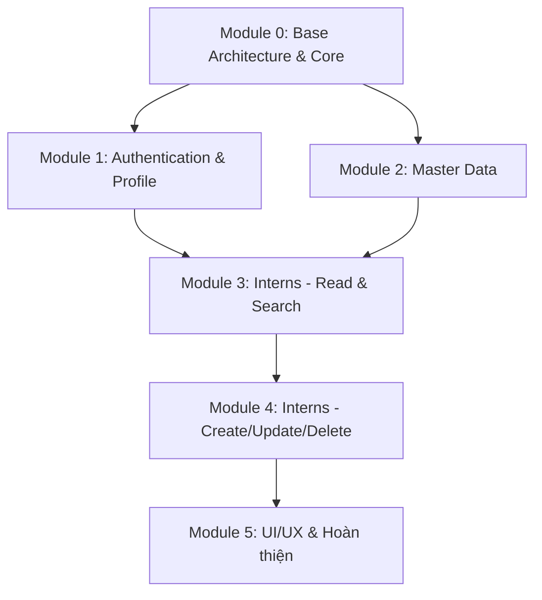

# Kế Hoạch & Phân Chia Module Dự Án Flutter (ManageIntern)

Tài liệu này phân chia dự án Flutter **ManageIntern** thành các module độc lập, có lộ trình rõ ràng để phát triển và kiểm thử theo từng giai đoạn.

---

## 🏗️ Tổng Quan Kiến Trúc Dự Án

Dự án áp dụng mô hình **Feature-driven / Layered Architecture** kết hợp thư viện quản lý trạng thái **Provider**:

```text
lib/
├── core/             # Nền tảng dùng chung (Network, Storage, Theme, Constants)
├── models/           # DTO & Data Models
├── services/         # Tầng gọi API qua Dio
├── providers/        # Quản lý State & Logic nghiệp vụ (ChangeNotifier)
├── screens/          # Giao diện người dùng theo từng tính năng (Feature-based)
├── widgets/          # Component UI tái sử dụng
└── main.dart         # Entry point & Cấu hình Routes
```

---

## 📦 Phân Chia Các Module Cần Làm



---

### Module 0: Khởi Tạo Nền Tảng (Base Architecture & Core Setup)
> **Mục tiêu:** Tạo bộ khung dự án, thiết lập kết nối mạng, bảo mật token và xử lý lỗi đồng nhất.

- [ ] **0.1. Cấu hình dự án:**
  - `pubspec.yaml`: Khai báo các dependencies (`dio`, `flutter_secure_storage`, `provider`, `intl`).
  - `analysis_options.yaml`: Cấu hình linter chuẩn cho code Flutter.
  - `.gitignore`: Loại bỏ các file tạm, build artifacts và môi trường.
- [ ] **0.2. Core Network:**
  - `ApiConstants`: Quản lý Base URL (hỗ trợ chuyển đổi giữa Android Emulator `10.0.2.2:8080`, iOS/Web `localhost:8080`, và IP LAN thiết bị thật).
  - `ApiResponse<T>` & `PageResponse<T>`: Class bọc response chuẩn từ Spring Boot backend.
  - `ApiClient`: Singleton bọc thư viện `Dio` tích hợp Interceptors (tự động gắn Bearer Token, logging, xử lý lỗi mạng & lỗi 401).
- [ ] **0.3. Core Storage:**
  - `TokenStorage`: Đọc/ghi Access Token, Refresh Token an toàn với `flutter_secure_storage`.
- [ ] **0.4. Theme & Constants:**
  - `AppColors`: Bảng màu chủ đạo và mã màu cho các trạng thái của Intern (`IN_PROGRESS`, `PASSED`, `FAILED`, `COMPLETED`).
- [ ] **0.5. Shared Widgets:**
  - `CustomTextField`: Ô nhập liệu có validation, icon và styling đồng nhất.
  - `CustomButton`: Nút bấm có trạng thái loading indicator.
  - `EmptyState`: Widget hiển thị khi danh sách trống hoặc lỗi kèm nút "Thử lại".

---

### Module 1: Xác Thực & Thông Tin Cá Nhân (Authentication & Profile)
> **Mục tiêu:** Xử lý luồng đăng nhập, lưu trữ phiên đăng nhập, kiểm tra trạng thái khởi động và hiển thị thông tin Mentor/Admin.

- **API tích hợp:**
  - `POST /auth/login` (Body: `username`, `password`)
  - `POST /auth/logout`
  - `GET /users/get-my-info` (Header: Bearer Token)
- **Công việc cụ thể:**
  - [ ] **1.1. Models:** `UserModel`, `RoleModel`, `LoginDataModel`.
  - [ ] **1.2. Service:** `AuthService` (gọi các endpoint xác thực).
  - [ ] **1.3. Provider:** `AuthProvider` (lưu trữ `currentUser`, `isAuthenticated`, `isLoading`, `errorMessage`).
  - [ ] **1.4. Screens:**
    - `SplashScreen`: Kiểm tra token đã lưu. Nếu còn hiệu lực chuyển sang Home, ngược lại chuyển sang Login.
    - `LoginScreen`: Form đăng nhập với validation, ẩn/hiện mật khẩu, dialog đổi Base URL nhanh khi test mạng LAN.
    - `ProfileScreen`: Hiển thị avatar, họ tên, email, chức vụ (Role), phòng ban và số lượng thực tập sinh đang phụ trách; nút Đăng xuất có dialog xác nhận.

---

### Module 2: Dữ Liệu Danh Mục Tĩnh (Master Data)
> **Mục tiêu:** Tải và cache danh sách phòng ban, vị trí và các đợt thực tập để phục vụ cho bộ lọc và dropdown tạo/sửa Intern.

- **API tích hợp:**
  - `GET /departments?page=0&limit=50`
  - `GET /positions?page=0&limit=50`
  - `GET /internship-batches?page=0&limit=50`
- **Công việc cụ thể:**
  - [ ] **2.1. Models:**
    - `DepartmentModel` (`id`, `title`, `mentorCount`)
    - `PositionModel` (`id`, `title`, `internCount`)
    - `InternshipBatchModel` (`id`, `name`, `startDate`, `endDate`, `status`, `internCount`)
  - [ ] **2.2. Service:** `MasterDataService` (gọi API lấy danh sách có phân trang).
  - [ ] **2.3. Provider:** `MasterDataProvider` (tải song song cả 3 danh mục khi app khởi động và lưu vào RAM).
  - [ ] **2.4. Screens / UI:**
    - `MasterDataScreen`: Tab xem nhanh danh sách Phòng ban, Vị trí và Đợt thực tập.

---

### Module 3: Quản Lý Thực Tập Sinh - Xem & Tìm Kiếm (Interns - Read & Search)
> **Mục tiêu:** Hiển thị danh sách thực tập sinh có phân trang, thanh tìm kiếm họ tên, lọc theo trạng thái và xem chi tiết.

- **API tích hợp:**
  - `GET /interns` (Query: `page`, `limit`, `keyword`, `status`, `position_id`)
  - `GET /interns/my-interns` (Danh sách riêng của Mentor đang đăng nhập)
  - `GET /interns/{id}` (Lấy thông tin chi tiết một Intern)
- **Công việc cụ thể:**
  - [ ] **3.1. Models:** `InternModel`, `InternNestedPosition`, `InternNestedMentor`, `InternNestedBatch`.
  - [ ] **3.2. Service:** `InternService.getInterns()` và `InternService.getInternDetail()`.
  - [ ] **3.3. Provider:** `InternProvider` (quản lý phân trang, infinite scroll, lọc theo từ khóa, lọc theo trạng thái, cờ bật "Chỉ thực tập sinh của tôi").
  - [ ] **3.4. Widgets:**
    - `StatusBadge`: Hiển thị huy hiệu màu sắc tương ứng với trạng thái Intern.
    - `InternCard`: Thẻ hiển thị tóm tắt thông tin trong danh sách.
  - [ ] **3.5. Screens:**
    - `InternListScreen`: Tìm kiếm họ tên, Filter chips, Pull-to-refresh (`RefreshIndicator`), cuộn tải thêm (`ScrollController`).
    - `InternDetailScreen`: Màn hình xem chi tiết toàn bộ thông tin Intern.

---

### Module 4: Quản Lý Thực Tập Sinh - Thêm, Sửa, Xóa (Interns - CRUD Mutation)
> **Mục tiêu:** Cho phép tạo mới, cập nhật thông tin và xóa thực tập sinh kèm dialog xác nhận.

- **API tích hợp:**
  - `POST /interns` (Body: `fullName`, `positionId`, `mentorId`, `internshipBatchId`, `startDate`, `endDate`)
  - `PUT /interns/{id}` (Body: Cập nhật thông tin và `internStatus`)
  - `DELETE /interns/{id}`
- **Công việc cụ thể:**
  - [ ] **4.1. Models:** `InternRequest` (DTO gửi lên backend).
  - [ ] **4.2. Service:** `createIntern()`, `updateIntern()`, `deleteIntern()`.
  - [ ] **4.3. Provider:** Bổ sung các action CRUD vào `InternProvider` và tự động làm mới danh sách khi thành công.
  - [ ] **4.4. Screens & Dialogs:**
    - `InternFormScreen`: Form dùng chung cho cả Tạo mới và Chỉnh sửa:
      - Ô nhập họ tên.
      - Dropdown chọn Vị trí (`Position`) lấy từ `MasterDataProvider`.
      - Dropdown chọn Đợt thực tập (`InternshipBatch`) lấy từ `MasterDataProvider`.
      - Chọn ngày bắt đầu và kết thúc bằng `showDatePicker`.
      - Dropdown chọn trạng thái (chỉ hiện khi chỉnh sửa).
    - Dialog xác nhận xóa trên `InternDetailScreen` hoặc `InternListScreen`.

---

### Module 5: Điều Hướng, Tối Ưu UX & Kiểm Thử (Navigation & Polishing)
> **Mục tiêu:** Ghép nối toàn bộ luồng, kiểm tra xử lý lỗi, điều hướng và tối ưu trải nghiệm người dùng.

- [ ] **5.1. Navigation & Main:**
  - `HomeScreen`: Quản lý `BottomNavigationBar` (Tab 1: Thực tập sinh, Tab 2: Danh mục, Tab 3: Tài khoản cá nhân).
  - Định tuyến (Routes) rõ ràng trong `main.dart`.
- [ ] **5.2. UX & Xử lý ngoại lệ:**
  - Tự động chuyển về màn hình Đăng nhập khi nhận lỗi 401 (token hết hạn).
  - Hiển thị SnackBar thông báo thành công / thất bại rõ ràng.
  - Dialog đổi Base URL linh hoạt khi test trên máy thật.
- [ ] **5.3. Kiểm thử & Chạy thử:**
  - Chạy `flutter pub get` và `flutter analyze`.
  - Chạy thử trên Android Emulator / Chrome / Thiết bị thật.

---

## 📌 Bảng Tóm Tắt Thứ Tự Triển Khai

| Thứ tự | Module | Trọng tâm chính | Kết quả đầu ra |
| :---: | :--- | :--- | :--- |
| **1** | **Module 0** | Base Architecture & Core | File cấu hình, Dio Client, Token Storage, Base Models |
| **2** | **Module 1** | Auth & Profile | Màn hình Login, Splash, Profile; lưu Token |
| **3** | **Module 2** | Master Data | Model & Service tải Phòng ban, Vị trí, Đợt thực tập |
| **4** | **Module 3** | Intern List & Detail | Danh sách phân trang, tìm kiếm, lọc status, xem chi tiết |
| **5** | **Module 4** | Intern Create/Edit/Delete | Form nhập liệu, DatePicker, Dropdown chọn Batch/Position, Xóa |
| **6** | **Module 5** | Hoàn thiện & Ghép luồng | Bottom Navigation, điều hướng, test kết nối backend |

